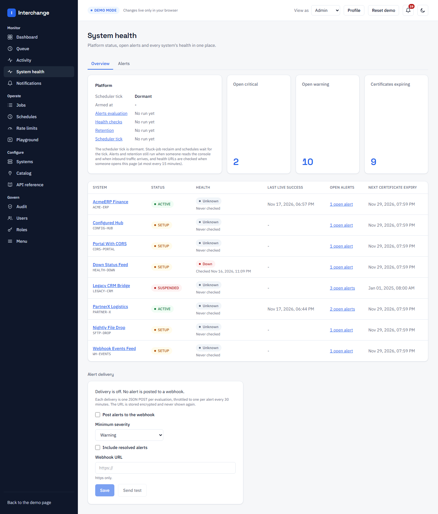
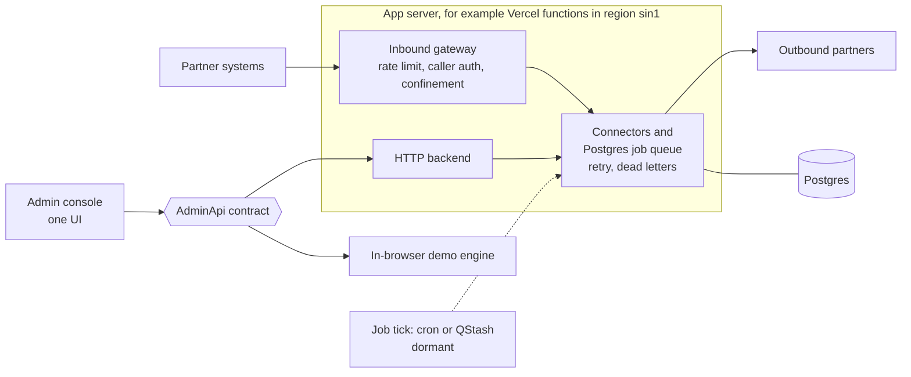
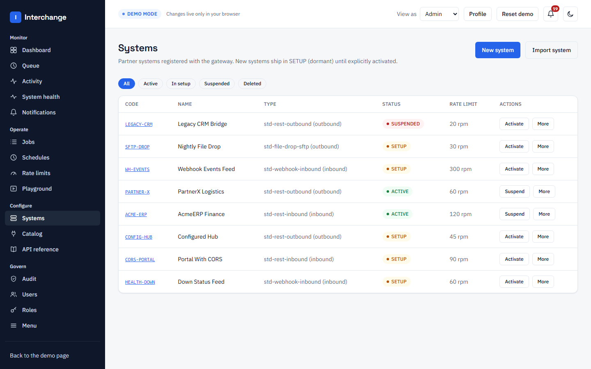
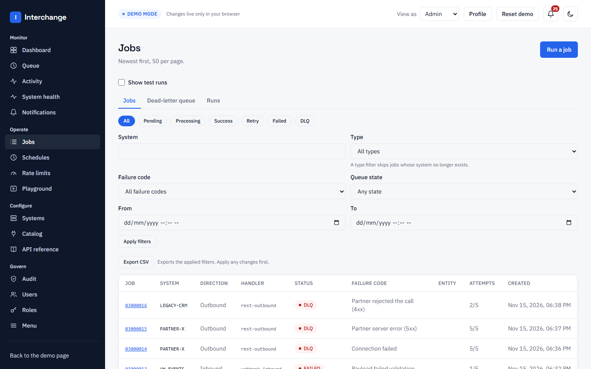
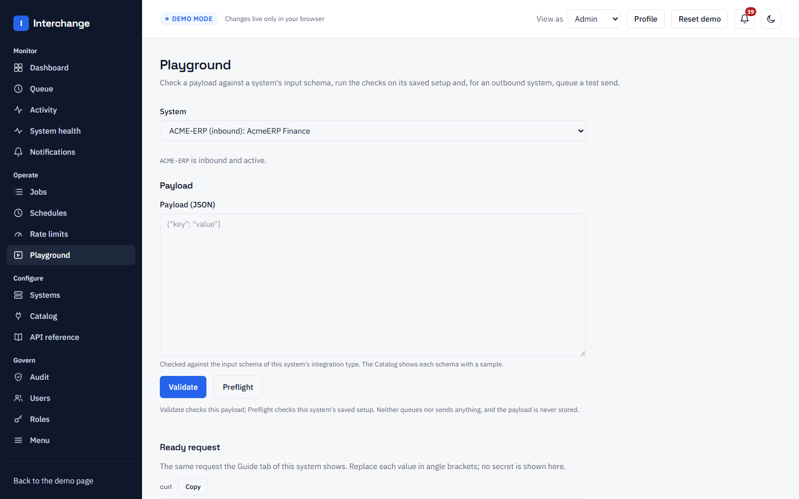
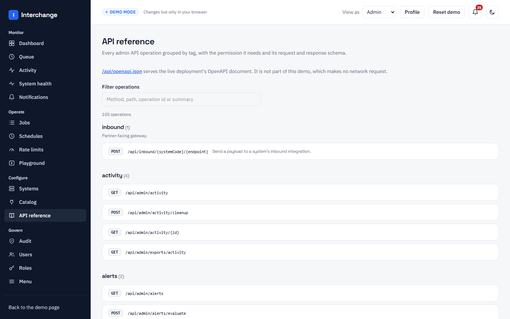
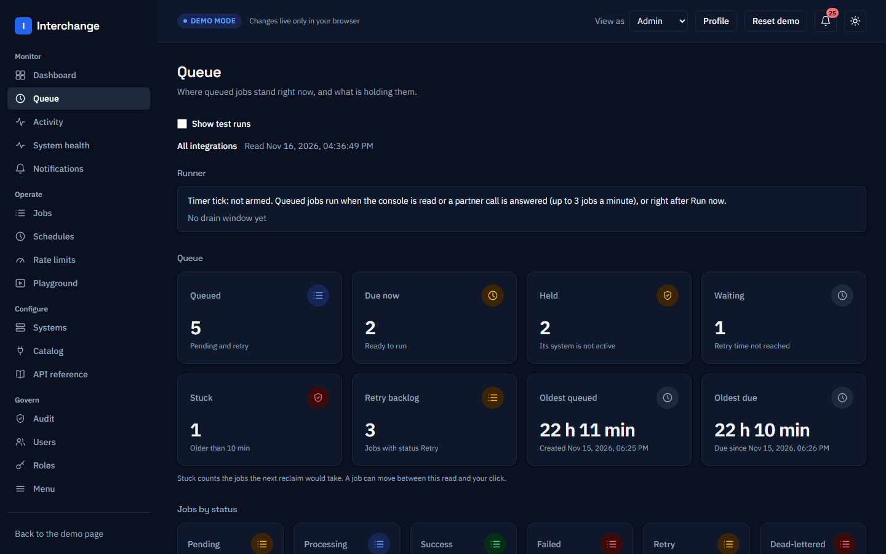
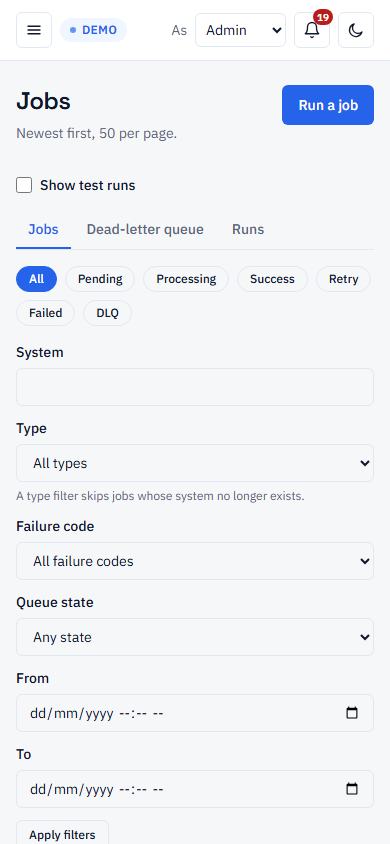

# Interchange

**Where every system meets and routes.**

Interchange is a vendor-neutral integration platform and API gateway. Partners never touch your core: every request passes through one governed point where it is authenticated, confined to its own system, rate-limited and logged. Systems, credentials, endpoints and schedules live in the database, so onboarding a partner is a console action with no redeploy. Outbound and scheduled work runs from a Postgres job queue with capped retry and a dead-letter queue, and an admin console with role-based access operates all of it.

## Live demo

**[Open the live demo](https://interchange-livid.vercel.app/demo)**

Choose Admin, Operator or Viewer with one click and use the whole console: run jobs, retry a dead letter, rotate a credential, read the alerts. Everything you do lives in your browser tab and resets on refresh. The demo makes no server calls. For a guided tour, read [docs/walkthrough.md](docs/walkthrough.md).

| | |
|---|---|
|  Dashboard |  System health with the Platform card and Alert delivery |

## At a glance

| | |
|---|---|
| Admin API endpoints | 107 |
| Alert rules | 8 |
| Console pages in the menu | 16 |
| Database tables | 32 core, plus 1 opt-in |
| Connector types | 4: REST inbound, REST outbound, webhook inbound, SFTP file drop |
| Built-in roles | 3: admin, operator, viewer |

## Architecture at a glance

- One console UI talks to one `AdminApi` contract. Two backends implement it: HTTP against `/api/admin/*`, and an engine that runs entirely in the browser, which is what this demo uses.
- The gateway order is fixed: rate limit by IP, authenticate the caller, confirm the URL's system code matches the caller, apply per-system limits, validate against the connector's schema, run, log.
- Inbound work runs inline, or is accepted with `202` when a partner sends `Prefer: respond-async` with an `Idempotency-Key` to a connector that opted in.
- Outbound and scheduled work drains from a Postgres queue. There is no Redis and no long-running worker.
- A job tick fires cron schedules exactly once. QStash (signed) or any cron that holds a shared secret can call it, and it stays dormant until an operator arms it or points a scheduler at it.
- Requirements: PostgreSQL and a Node 22 host, or Docker Compose for the whole stack ([self-hosting](docs/deployment.md#self-hosting)). Vercel, Neon and QStash are optional.
- The hosted demo runs on Vercel in region `sin1`, next to its Neon database, to keep each query's round trip short.

More in [docs/architecture.md](docs/architecture.md).

## Screenshots

Taken from the live demo, in addition to the two above. All data is fictional.

| | |
|---|---|
|  Systems |  System detail |
|  Jobs |  Job detail of a dead letter, with Retry and Discard |
|  Queue |  Playground |
|  API reference |  Roles |
|  Dashboard, dark theme |  Queue, dark theme |
|  Dashboard on a phone |  Jobs on a phone |

## Flows to try

Each flow has its steps in [docs/walkthrough.md](docs/walkthrough.md).

1. Switch between Admin, Operator and Viewer with **View as** and watch the menu and the actions change.
2. Run a job from the Jobs page, then read its step timeline.
3. Retry a dead letter, or discard it with a note.
4. Rotate a credential with a grace window, then revoke it.
5. Validate a payload in the Playground, then run **Preflight**.
6. Click any number on the Queue page: Jobs opens with the same total.
7. Open System health, save a webhook URL and press **Send test**.
8. Press **Reset demo** to return to the seed data.

## Features

**Gateway.** Partners authenticate with an API key, a Bearer token or Basic credentials, and are confined to their own system's routes: a credential presented on another system's route gets 403 and a log row. An integration type can also require a short-lived service token as a second credential. Per-IP and per-system rate limits answer 429 with `Retry-After`, per-endpoint limits double as an allowlist, unknown payload keys are refused by name, and a body over 1 MiB is refused with 413. See [Caller authentication](docs/caller-auth.md) and [Rate limiting](docs/rate-limiting.md).

**Credentials.** Inbound credentials are hashed. Outbound credentials (API key, static bearer, OAuth 2.0 client credentials, Basic, and an on/off flag) are encrypted with AES-256-GCM, pinned to the origins you list and sent only there. Issue, rotate with an optional grace window and revoke from the system's page; a revoke applies from the next job. Revealing a stored outbound secret is off by default. See [Security](docs/security.md) and [Caller authentication](docs/caller-auth.md).

**Systems and connectors.** A connector is a self-contained module with a small `execute` contract, turned into a static manifest by a build step. Adding a type is a folder plus a rebuild; registering partner instances of an existing type is a console action. Systems can be suspended, soft-deleted and restored, duplicated, and exported or imported without any secret. Each system can hold certificates, an SFTP connection with a pinned host key, and one S3-compatible object store. See [Connectors](docs/connectors.md) and [Security](docs/security.md).

**Job engine.** Jobs retry with capped, jittered backoff that honours a partner's `Retry-After`: 429 and 5xx retry, other 4xx fail at once. Exhausted jobs go to a dead-letter queue where an operator retries or discards them with a note. Stuck jobs are reclaimed, schedules can be run on demand, and every run of the tick, a drain or a retention pass is recorded. See [Architecture](docs/architecture.md).

**Observability and alerting.** Eight rules raise deduplicated alerts and per-user notifications, and a System health page shows platform status, open alerts and each system's health. Health URLs are probed by the scheduler tick once it is armed (and, while it is dormant, at most every 15 minutes when someone opens System health), and alerts can be posted to one https webhook with a 30 minute throttle per alert. The Queue page counts jobs by state and every number opens the Jobs list with the same total. The Activity log records every inbound and outbound call with secrets redacted. See [Alerting](docs/alerting.md).

**Console and access control.** Permissions are checked against the database on every request, sessions last 8 hours, and disabling a user or revoking sessions ends every session at once. An admin manages users and roles under Govern, reorders or hides menu entries and pins systems. A job's payload loads on demand, redacted, for roles that hold the permission, and each view is audited. See [Security](docs/security.md).

**Developer tools.** A generated OpenAPI 3.1 document covers the admin API and the inbound gateway. The console has an API reference page, a Guide tab on every system with curl examples that use placeholder credentials, and a Playground that validates a payload and runs preflight checks on a system's saved setup. See [Architecture](docs/architecture.md).

**Security.** The platform checks every URL it calls against private and reserved address ranges, before connecting and again at connect time, and follows no redirects. Responses carry a per-request Content-Security-Policy with a nonce and HSTS, CORS is off unless an origin is allowed, and the audit log keeps a diff built from an allowlist of fields. A fresh deploy is dormant: systems start in setup, no schedule is armed and nothing consumes recurring quota. See [Security](docs/security.md) and [Deployment](docs/deployment.md).

## What differs in the demo

- **State lives in the browser.** A refresh or **Reset demo** restores the seed data. Users, roles and the menu layout live there too, with the same guards as the deployed console.
- **No inbound gateway.** The `202` async path exists only in the deployed server. A seeded job shows the async state as "Accepted async (202)" on its detail page.
- **Alerts run in the browser** over the fictional data. On System health, **Send test** answers without sending anything, and it stays disabled until you save a webhook URL.
- **No real partner is reached.** The Playground's preflight skips its DNS step, a send runs the in-browser job engine, and the Storage tab accepts only hosts ending in `.storage.example`.
- **The API reference** loads its OpenAPI document from a script shipped with the console, with no API call.
- **The demo password** `Demo-Passphrase-2026-Fiction` is a published, fictional value. The demo Profile page shows it so you can try the change-password rules.

## Docs

- [Walkthrough](docs/walkthrough.md): a guided tour of the live demo.
- [Architecture](docs/architecture.md): system design, the connector model, the job engine, the dormant posture.
- [Security](docs/security.md): the credential vault, inbound authentication and cross-system confinement, rate limiting, permission-based access control, and the threat model.
- [Caller authentication](docs/caller-auth.md): API keys, Bearer and Basic credentials, per-system service keys, the gateway order and what a refused caller sees.
- [Rate limiting](docs/rate-limiting.md): every limiter with its key and default, the `429` headers, the fixed window and the fail-open rule.
- [Connectors](docs/connectors.md): the connector contract, the catalog, and adding a new connector type step by step.
- [Alerting](docs/alerting.md): the eight rules, evaluation triggers, webhook delivery and its throttle, the Test action and scheduled health checks.
- [Deployment](docs/deployment.md): environment variables, the dormant first deploy, arming the scheduler, and the deploy and health workflows.

## Status

Feature complete for a single team. Production runs dormant, with no partner systems connected. CI deploys `main` to production behind a migration gate, and an hourly workflow checks the deployment's health (GitHub runs it on a best-effort schedule, see [Deployment](docs/deployment.md)).

Stack: Next.js (App Router), Drizzle ORM, PostgreSQL (Neon serverless or node-postgres), TypeScript and zod. The hosted demo is deployed on Vercel; you can also self-host with Docker Compose.

## Note

This is a public showcase. The source lives in a private repository. All data shown in the demo is generic and fictional.
