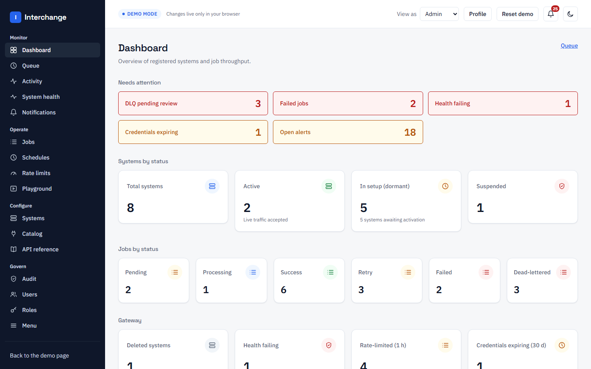
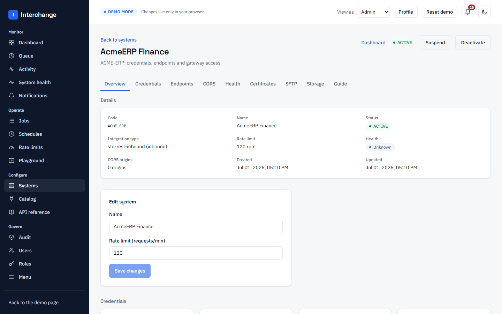
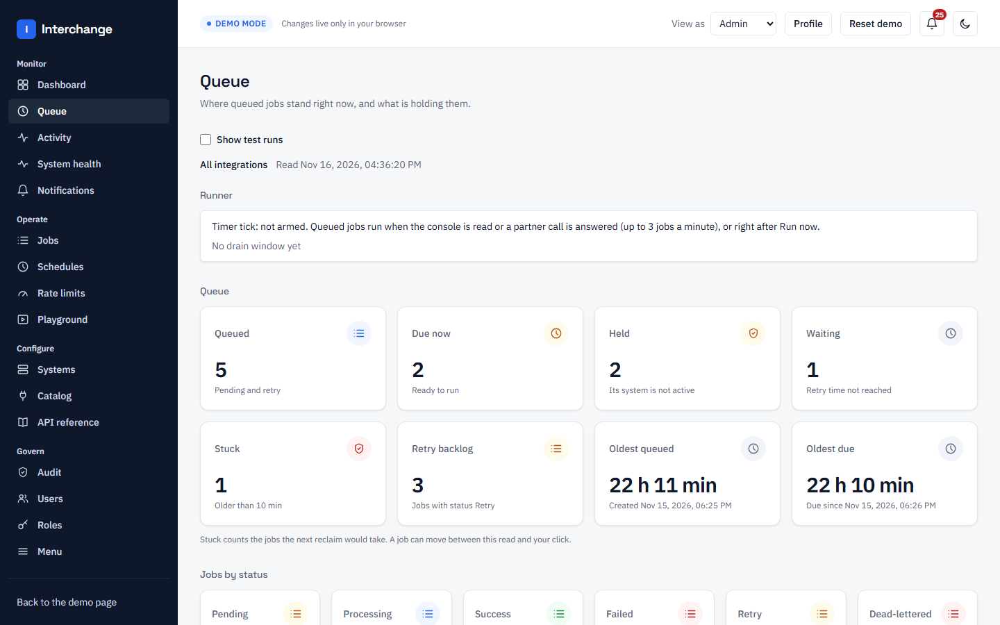
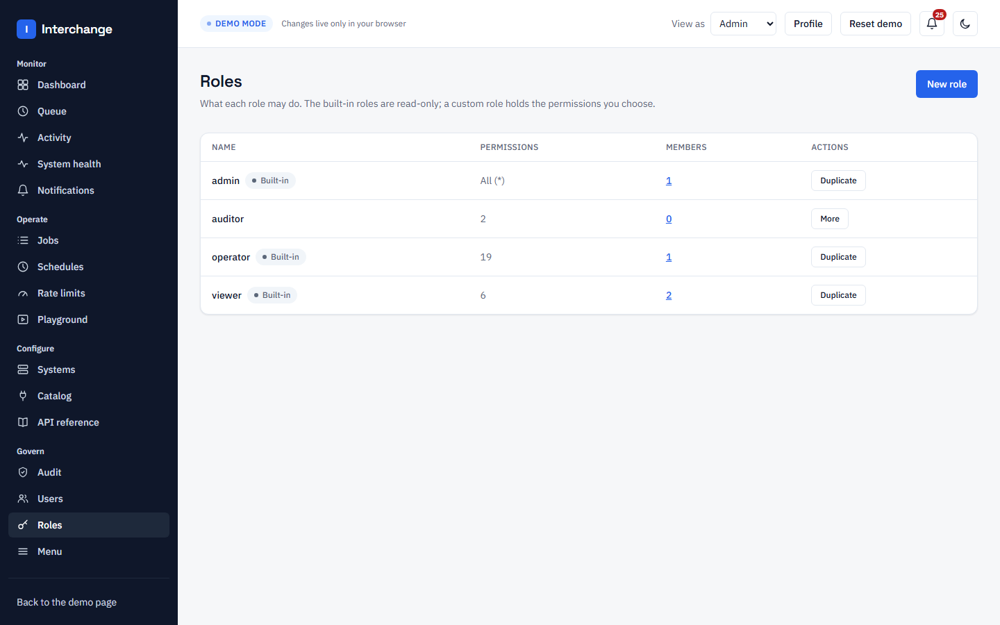
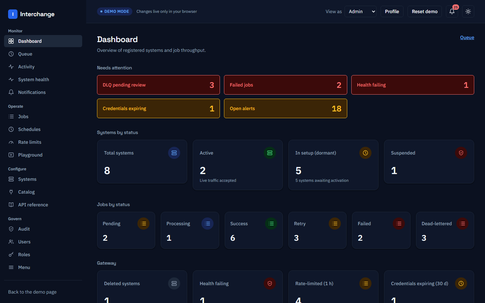
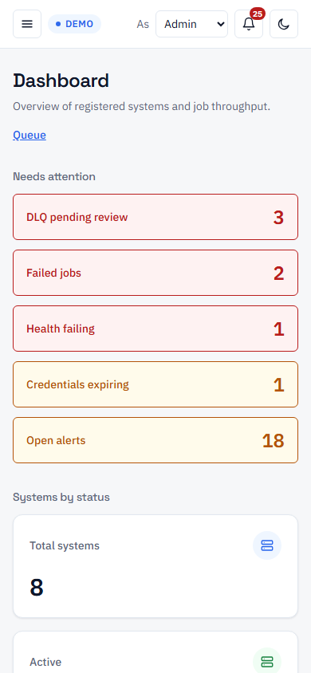

# Interchange

**Where every system meets and routes.**

Interchange is a vendor-neutral integration platform and API gateway. It is the single governed junction for all your external systems: partners never touch your core, and every request passes through one controlled point where it is authenticated, validated, rate-limited, and logged.

## Live demo

Try the fully interactive demo. Log in with one click and use the whole console: register connectors, activate systems, run jobs and watch them flow through the lifecycle, receive notifications, browse the audit trail.

**[Open the live demo](https://interchange-livid.vercel.app/demo)**

Everything you do in the demo lives only in your browser. Refresh the page and it resets to a clean state. The demo makes zero database calls, so it stays pristine for every visitor.

## Screenshots

Taken from the live demo. All data is fictional.

| | |
|---|---|
| <br>Dashboard | <br>Systems |
| <br>System detail | <br>Queue |
| <br>Jobs | <br>Playground |
| <br>API reference | <br>Roles |
| <br>Dashboard, dark theme | <br>Queue, dark theme |
| <br>Dashboard on a phone | <br>Jobs on a phone |

## Flows to try

1. Switch between Admin, Operator and Viewer with **View as** at the top of the console, and watch the menu and the available actions change.
2. Run a job from a system's page, then follow it on **Jobs** to its detail page and step timeline.
3. Open a job whose dead letter awaits review and replay it, or discard it with a note.
4. In the **Playground**, pick a system, validate a payload, then run **Preflight** on the system's saved setup.
5. On a system's **Credentials** tab, rotate a credential with a grace window, then revoke it.
6. On the **Menu** page under Govern, reorder or hide sidebar entries and pin a system.
7. On the **Queue** page, click any number: **Jobs** opens with the same filter and the same total.
8. Press **Reset demo** to return to the seed data.

## What it does

- **Pluggable connectors.** A connector is a self-contained module with a small `execute` contract. Adding a connector type is a code change plus a rebuild; registering unlimited partner instances of an existing type is a pure UI action, with no redeploy.
- **Config-driven, not hardcoded.** Systems, integration types, credentials, endpoints, and schedules live in the database. Outbound credentials are encrypted at rest with AES-256-GCM; inbound API keys, bearer tokens and Basic credentials are hashed. Everything is managed through the admin console.
- **One governed inbound gateway.** External partners authenticate with an API key, bearer token or Basic credentials and are confined to their own system's routes. A partner cannot reach another partner's endpoints. Every request is rate-limited and logged.
- **Provisioned-dormant by default.** A fresh deploy ships fully built but idle. Systems start in a setup state, no schedules are armed, notifications are off. Nothing runs, and nothing consumes recurring hosting quota, until a project explicitly activates it.
- **Serverless-native job engine.** Inbound work runs inline by default, or is accepted with `202` when a partner sends `Prefer: respond-async` with an `Idempotency-Key` to a connector that opted in. Outbound and scheduled work drains from a Postgres-backed queue with retry, backoff, and a dead-letter queue that supports replay. No Redis, no long-running worker.

The browser demo has no inbound gateway, so the `202` async path exists only in the real server; a seeded job in the demo shows the async state ("Accepted async (202)" on its detail page).

## How a request flows

```
partner request
   -> inbound gateway rate-limits by IP, then authenticates the caller (API key / bearer / basic)
      and confirms the URL system code matches the caller (no cross-system access)
   -> if the system's integration type requires it, a short-lived service token must be presented as well
   -> the per-system rate limit (and any per-endpoint limit) is applied; the system must be ACTIVE (a dormant system rejects traffic)
   -> the bound connector validates the payload against its schema
   -> the connector runs; a job row records the outcome
   -> every outcome (including rejections) is logged; outbound/scheduled work drains from a queue with retry + DLQ
```

## What exists today

Built and working in the real application:

- Inbound gateway with API key, bearer and Basic authentication, per-system confinement (a credential presented on another system's route is refused with 403 and logged), per-IP and per-system rate limiting (`X-RateLimit-*`, `Retry-After`, fail-open), request ids, idempotent retries, and an activity log row for every outcome. Also: an optional short-lived service token as a second credential per integration type, per-endpoint limits that double as an endpoint allowlist, strict payloads (unknown keys are refused by name), per-system CORS origin lists, and optional async acceptance (`202 Accepted` for `Prefer: respond-async`, with an encrypted, 24 hour payload copy and a safe replay as the status poll).
- Credential lifecycle: issue API keys, bearer tokens and Basic credentials (optional label and expiry), rotate with an optional grace window, revoke, and list with Active, Rotating, Expired and Revoked status; store, rotate and revoke outbound credentials; labels are unique per system; revealing a stored outbound secret is off by default and needs both a permission and a server flag. Outbound credentials come in five types (API key, static bearer token, OAuth 2.0 client credentials with a platform-managed token cache, Basic and a secret on/off flag), can be stored once per integration type as defaults that a system overrides by label, are bound to an endpoint by an auth label and are sent only to an origin the credential is pinned to. Decrypted values are cached per instance behind version counters, so a revoke applies from the next job, and a missing or unusable credential dead-letters the job at attempt 1 as `CREDENTIAL_MISSING` or `CREDENTIAL_INVALID`.
- System detail page in the console: overview with credential status counts, a credentials tab for issuing, rotating, revoking and revealing, and tabs for endpoint config and limits, CORS origins, health, certificates and SFTP.
- System lifecycle: soft delete and restore (a deleted system is unknown at the gateway, and its code stays reserved), duplicate, and export and import of a system's configuration (never any credential, certificate or SFTP secret). Suspended systems fire no schedules and hold their queued jobs, with no catch-up when they resume.
- Outbound SSRF guard: URLs the platform calls (connector base URLs, health URLs) are checked against private and reserved address ranges before connecting and again at connect time, redirects are not followed, and failures surface as fixed codes. The SFTP host gets the same check, with one DNS resolution whose checked address is the one dialled.
- Certificates and SFTP per system: upload a certificate (optionally with its private key, which is encrypted, checked against the certificate and never returned), see Valid, Expiring, Not yet valid, Expired and Revoked counts that open the matching list, and revoke. Save an SFTP connection (password or private key, write-only), pin the server's host key, and run a rate-limited connection test that refuses to authenticate before a key is pinned. New `certificates:write`, `sftp:write` and `sftp:test` permissions, held by the operator role.
- Connector catalog: every connector's input as a JSON Schema plus a validated sample, generated at build time.
- Operations screens: a rate-limit monitor (current buckets and the last hour of 429s, client IPs truncated), an expiring-credentials list, a health check per system, and a Gateway section on the dashboard.
- Security headers: a per-request Content-Security-Policy with a nonce, HSTS over https, and CORS off unless an origin is allowed (an env allowlist for `/api/*`, each system's own origin list for inbound); a per-IP and per-user rate limit on the admin API (429 with `Retry-After`, fail-open).
- Encrypted credential vault, connector manifest and catalog, Postgres-backed job queue with retry (capped, jittered backoff that honours a partner's `Retry-After`; 429 and 5xx retry, other 4xx fail at once), a dead-letter queue that keeps the partner's masked error text behind `logs:payload`, a throttled after-response drain, stuck-job reclaim, and cron schedules fired exactly once by one signed QStash tick (dormant until an operator arms it). Schedules can be created, edited, soft deleted and restored, and run on demand at most once per 10 seconds.
- Admin console with working sign-in, permission-based access control (checked against the database on every request, 8 hour sessions, throttled sign-in), and pages for systems, catalog, jobs, schedules and audit.
- A typed admin API: one `AdminApi` contract, implemented over HTTP (`/api/admin/*`, one catch-all route driven by an endpoint registry, every request through `withAdmin`) and in the browser for the demo, behind a single client UI. One contract test suite runs against both implementations.
- Manual job run, DLQ replay and DLQ discard from the console, gated by the `jobs:run`, `jobs:retry` and `jobs:discard` permissions. A replay or discard can carry a note (required for a discard), and only an item still awaiting review can be acted on.
- Job detail: each job has a page with its metadata, an ordered step timeline with durations, a failure code from a fixed list and its dead-letter history. The payload loads on demand, redacted, and only for roles that hold `logs:payload`; each view is audited. A job whose dead letter still awaits review can be retried or discarded from its own page, under the same permissions and note rules.
- Process log: every scheduled tick, dispatch, drain and retention run is recorded, a duplicate QStash delivery runs nothing, and the Jobs page has a Runs view. Retention (`jobDays`) ages out jobs, step logs and runs under the same kill switch.
- Audit search: the audit log filters by action, actor, target and date range (kept in the URL), pages by 50, and shows a server-rendered diff built from an allowlist that hides any field it does not recognise.
- Activity log screen: every inbound and outbound call is recorded with secrets redacted before storage; filters kept in the URL, payloads loaded on demand for roles that hold `logs:payload`, CSV export, cleanup, and an editable retention setting. Test runs of jobs stay out of the live counts unless "Show test runs" is on.
- Queue page (P4d): where queued jobs stand right now, as Queued, Due now, Held, Waiting and Stuck, all read at one instant, with a runner panel (timer tick not armed, armed, or armed but refused) and tables by integration type and by system. Every number links to the Jobs list with the same filter and total (`queue` and `asOf` are new Jobs filters, and the export honours them). Reading it never starts a drain. In this demo every state is non-zero in the fictional data.
- File upload (P4d): the Run drawer of a `file-drop-sftp` system offers "File to send". The file travels inside the job payload through the existing manual run, up to 45 KiB, with strict base64 and a safe filename checked the same way on every backend. The connector itself is still a no-network template stub.
- Per-system service keys (P5b): on an integration type with the `partner+service` policy, a caller also sends a short-lived HS256 token in `X-Service-Token`. The token names a service key issued to its own system in `kid` and must carry `sys` equal to the system code in the URL. A key is shown once, rotates with an optional grace window and stops working on the next call after a revoke. See [Caller authentication](docs/caller-auth.md).
- Users, roles and sessions (P5a): the Users and Roles pages under Govern, and a Profile page (no nav entry) for your own name, password and sessions. An admin adds a user with one or more roles and receives a one-time 20-character temporary password, shown once and never stored in plaintext (there is no email service and no forced change at first sign-in). Disabling a user, resetting a password, revoking sessions, changing your own password or choosing "Sign out everywhere" ends every session of that user at once, on every device, because each admin call checks the user's `token_version`; the console then signs out and shows the reason on `/login`. The built-in roles `admin`, `operator` and `viewer` are read-only (the seed restores them); custom roles are editable. Guards: you cannot grant permissions you do not hold, you cannot manage a user or role that outranks you (an equal rank is allowed), you cannot disable yourself or reset your own password (use Profile), the last active superadmin cannot be removed, and a role with members cannot be deleted. New passwords need at least 12 characters and at most 72 UTF-8 bytes, must differ from the current one and must not contain the email local part (when it has 4 or more characters); changing a password is limited to 5 attempts per user per 15 minutes. Sign-in trims and lower-cases the email. The admin API now has 104 endpoints and the console has 16 navigation entries. In this demo, users and roles live in your browser with the same guards, and the demo password `Demo-Passphrase-2026-Fiction` (a published fictional value) is shown on the demo Profile page, so you can try the change-password rules.
- Console UX and menu layout (P5d): a Menu page under Govern where an admin reorders the sidebar entries within their groups, hides entries and pins up to 10 systems as shortcuts, with the same rules as the live console. Also: the Systems page pages by 50, focus moves to the page heading after a route change, per-system rows on the Queue page link to the Queue for that system, and a rejected credential store or rotate clears only the secret field. In this demo the layout lives in your browser and resets with the demo.
- API reference, integration guide and playground (P5e): a generated OpenAPI 3.1 document that covers the admin API and the inbound gateway (public at `GET /api/openapi.json` on the live console), an API reference page under Configure, an integration guide (a Guide tab on each system and a type-level guide from the Catalog) with curl examples that use placeholder credentials only, and a Playground under Operate that validates a payload, runs fixed-text preflight checks of a system's saved setup and can send a test request for an active outbound system (`jobs:run`, audited, rate limited). In this demo the API reference loads the document from a script chunk shipped with the console (no API call), the preflight DNS step is not run, and a send runs the in-browser job engine, so nothing reaches a real partner.
- Object storage (P5f): a Storage tab on each system page for one S3-compatible store: endpoint, region, bucket, prefix and a write-only secret access key, a connection test, and a browser with folders, paging, Download (a presigned link valid 60 seconds, opened after a confirm that names the storage host), Move and Delete. Keys are confined to the configured prefix, and audit rows hold a short hash of a key, never its name. It adds 8 endpoints (104 in all) and the permissions `storage:read` and `storage:write` (held by `operator`). In this demo the bucket lives in your browser: only endpoints on a `*.storage.example` host are accepted, nothing reaches a real store, and Download opens a `blob:` link to the object's bytes.
- Edge hardening (P5z): unknown paths answer 404 (a JSON `not found` under `/api`), and the inbound gateway refuses a body over 1 MiB with 413, including a chunked body with no declared length.
- CI on every push: regenerate the connector manifest and the OpenAPI document, typecheck, lint, `audit:log-calls`, tests (against an in-memory Postgres, drift tests for both generated files included), build, and `test:smoke`, a Playwright walk of every `/demo` route for each role with an axe scan and a check that the demo makes no `/api` request.

Alerting is built (P3c): seven rules (dead letters, job failure rate, inbound error rate, certificate expiry, system down, stale scheduler tick, stuck jobs) raise deduplicated alerts and per-user notifications, with a System health page and an admin "Evaluate now" action. In this demo the rules run in your browser over the fictional data. Alert messages carry only codes, counts, labels and dates, never payload text.

## Docs

- [Architecture](docs/architecture.md): system design, the connector model, the job engine, the dormant posture.
- [Security](docs/security.md): the credential vault, inbound authentication and cross-system confinement, rate limiting, permission-based access control, and the threat model.
- [Caller authentication](docs/caller-auth.md): API keys, Bearer and Basic credentials, per-system service keys, the gateway order and what a refused caller sees.
- [Rate limiting](docs/rate-limiting.md): every limiter with its key and default, the `429` headers, the fixed window and the fail-open rule.
- [Connectors](docs/connectors.md): the connector contract, the catalog, and adding a new connector type step by step.
- [Deployment](docs/deployment.md): environment variables, the dormant first deploy and arming the scheduler.

## Stack

Next.js (App Router) + Drizzle ORM + Neon serverless Postgres, deployed on Vercel. TypeScript throughout, zod for validation.

## Note

This is a public showcase. The source lives in a private repository. All data shown in the demo is generic and fictional.
