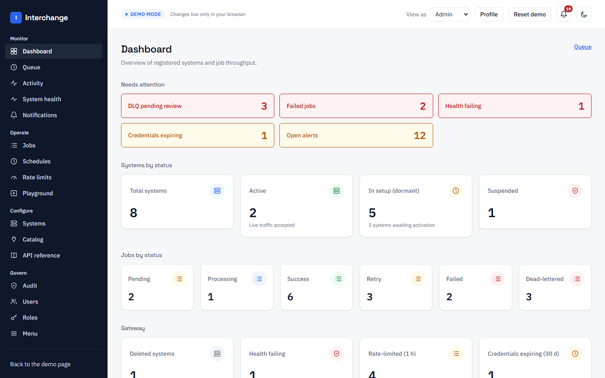
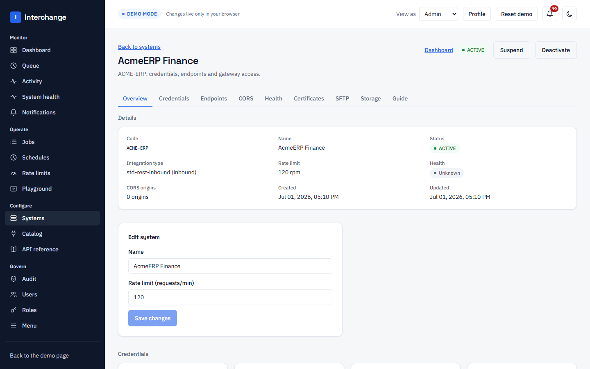
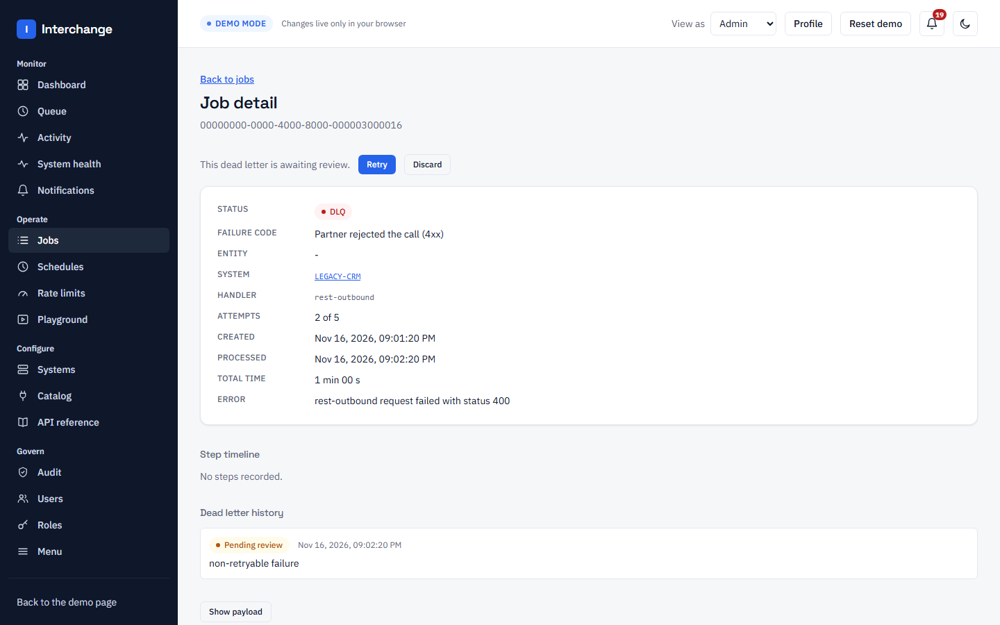
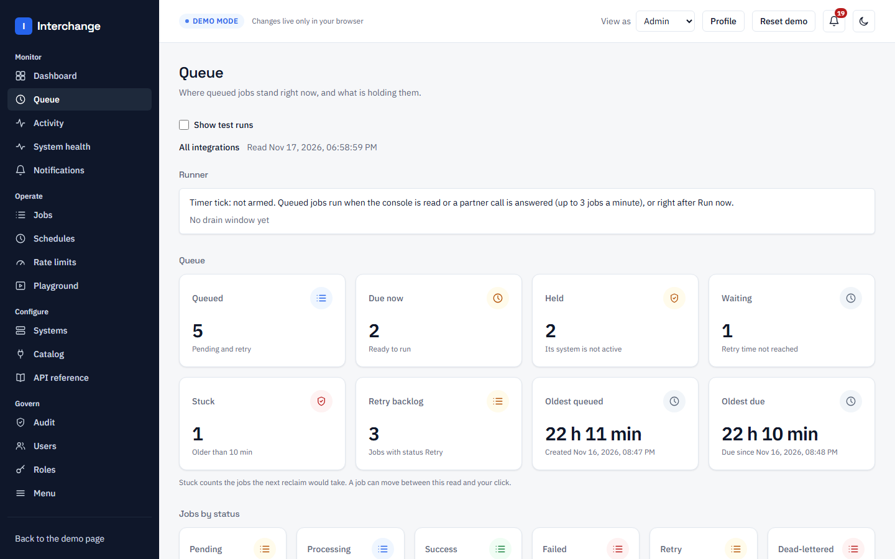
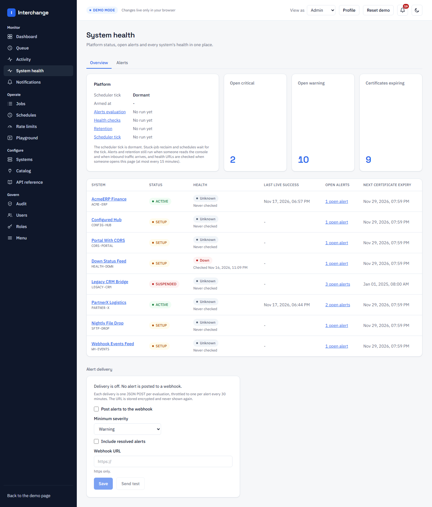
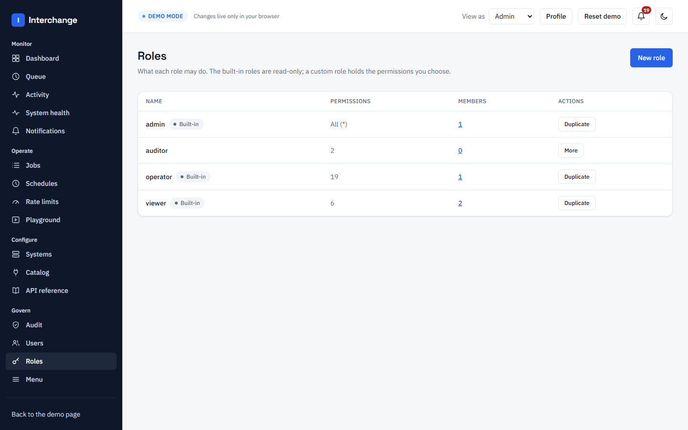

# Walkthrough of the live demo

Last updated: 2026-11-17

This tour follows an operator through the console at https://interchange-livid.vercel.app/demo. It takes about fifteen minutes. Every name on screen is fictional, and everything you change lives in your browser tab only.

## 1. Open the demo and pick a role

The landing page offers three entries: **Enter demo as Admin**, **Operator** and **Viewer**. Admin can do everything, Operator runs jobs and registers systems, Viewer can only look. Start as Admin so every control is visible. A **Demo mode** badge in the header reminds you that no server is involved, and the **View as** menu next to it switches role at any time without losing your changes.

The menu on the left has four groups: Monitor, Operate, Configure and Govern. A role sees only the pages its permissions open.

## 2. Dashboard

The Dashboard opens with **Needs attention**: dead letters awaiting review, failed jobs, systems whose health check failed, credentials about to expire and open alerts. Below it come **Systems by status**, **Jobs by status**, **Gateway** (deleted systems, failing health, rate-limited requests in the last hour, expiring credentials) and **Recent jobs**. Each card is a link, and the number on the card is the total of the list it opens.

## 3. Catalog and Systems

Under Configure, **Catalog** lists the integration types: each one binds a connector to an authentication policy. **Systems** lists the partner systems registered on those types, with their status (setup, active or suspended), health and rate limit. A new system starts dormant in setup and accepts no traffic until you activate it. The four connector types are described in [connectors.md](connectors.md).

## 4. A system's page: Credentials

Open any system. The tabs are Overview, Credentials, Endpoints, CORS, Health, Certificates, SFTP, Storage and Guide. On **Credentials**:

- Under **Issue a credential**, press **Issue API key**. The secret appears once, in a banner, and is never shown again.
- On a row, press **Rotate**, set **Grace period (minutes)** to 30 and press **Confirm rotate**. The old secret keeps working for those 30 minutes and its row shows **Rotating**. A grace period of 0 ends the old secret at once.
- Open **More actions** on a row and choose **Revoke**, then **Confirm revoke**. The row turns **Revoked**, and anything presenting that credential is refused from the next call.

How the gateway checks these credentials is in [caller-auth.md](caller-auth.md).

## 5. Run a job and read its timeline

Open **Jobs** under Operate and press **Run a job**. Choose an active outbound system, keep the example payload and press **Run job**. Leave **Test run** off, because test runs stay out of the live lists. The new job appears in the list with a status that moves from Pending to Success, Retry or Failed.

Open the job by its id. The detail page shows its system, handler, **Attempts** (for example 1 of 5), any **Failure code**, the **Step timeline** with a duration per step, and **Dead letter history**. The payload loads on demand and only for roles that may read it.

## 6. A dead letter: retry or discard

On the Jobs page, switch the view tab to **Dead-letter queue**. Each row is a job that ran out of attempts, or failed in a way a retry cannot fix (a partner's 4xx, for example), and now waits for a person. Two actions are available:

- **Retry** opens **Retry this dead letter**. The **Note (optional)** field records why, and **Retry job** queues a fresh attempt.
- **Discard**, found under the row's menu, opens **Discard this dead letter**. The **Note (required)** field must be filled before **Discard job** is enabled.

Only an entry still awaiting review can be acted on, and the note appears in the job's **Dead letter history** and in the audit log. The same buttons appear on the job's own page.

## 7. Queue numbers open the same Jobs total

Open **Queue** under Monitor. The cards **Queued**, **Due now**, **Held**, **Waiting** and **Stuck** are all read at one instant, and the **Runner** panel says what is draining the queue. Click any number: Jobs opens with the same filter and the same total. The tables **By integration type** and **By system** work the same way, and a system name narrows the whole page to that system.

## 8. Playground and API reference

**Playground** under Operate checks a payload without sending it. Pick a system, paste or edit the **Payload (JSON)**, then press **Validate** to check it against the system's input schema or **Preflight** to run fixed checks on the saved setup. Both are read only. For an active outbound system, **Send as test** queues a test job, which in the demo runs on the in-browser engine.

**API reference** under Configure renders the OpenAPI document for the admin API and the inbound gateway.

## 9. System health

Open **System health** under Monitor. The **Platform** card shows the **Scheduler tick** state and **Armed at**, then one row per kind of background run: **Alerts evaluation**, **Health checks**, **Retention** and **Scheduler tick**. Each row links to its runs on the Jobs page. The **Health checks** row shows when a health URL was last probed. Next to it sit **Open critical**, **Open warning** and **Certificates expiring**, and below it a table with every system's health.

The **Alerts** tab lists what the eight rules raised. The seeded data already opens a critical queue backlog alert, and Admin can press **Evaluate now** to re-run the rules. The rules are described in [alerting.md](alerting.md).

At the bottom is the **Alert delivery** panel. Turn on **Post alerts to the webhook**, choose a **Minimum severity**, enter a public https address under **Webhook URL** and press **Save**. **Send test** stays disabled until a URL is saved, and in the demo it answers `Not delivered: DEMO_NO_NETWORK` without sending anything. The deployed app posts to the webhook for real and sends the same alert change at most once every 30 minutes.

## 10. Govern: View as, Roles, Menu, Audit

Switch **View as** to Operator, then Viewer, and watch the menu shrink and the buttons disappear. Then return to Admin:

- **Roles** lists the built-in roles, marked **Built-in** and read-only, and any custom role you create from a chosen set of permissions.
- **Menu** lets you reorder the sidebar within its groups, hide entries and pin up to 10 systems. Hiding an entry removes it from the sidebar only and grants nothing.
- **Audit** lists privileged actions, newest first, searchable by action, target, actor and time. The credential you rotated and the webhook you saved are both there. Security details are in [security.md](security.md).

## 11. Reset demo

Press **Reset demo** in the header. The button changes to **Click again to confirm**, and a second click within three seconds restores the seed data. On a narrow screen it sits at the bottom of the menu drawer. Refreshing the page does the same.

## What the demo does not do

- **No inbound gateway.** The browser has no URL for a partner to call, so the authentication order, per-system confinement and the `202` async path exist only in the deployed app. One seeded job shows the async state as **Accepted async (202)**.
- **No network calls.** The console makes no request to any server. Sends, health probes and the webhook test are simulated, and nothing reaches a real partner. [rate-limiting.md](rate-limiting.md) covers the limits the deployed gateway enforces.
- **State lives only in the browser.** A refresh or **Reset demo** returns every system, job and role to the seed. Nothing is stored anywhere else.

To see how the deployed platform is built and run, read [architecture.md](architecture.md) and [deployment.md](deployment.md).
